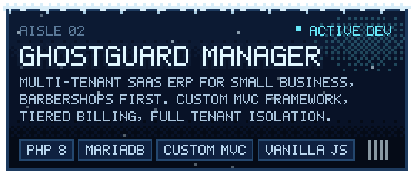
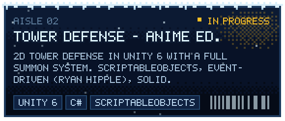
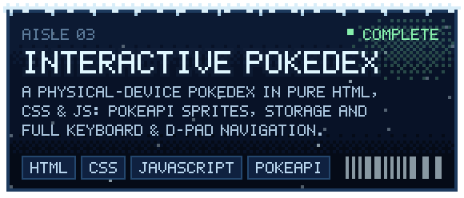
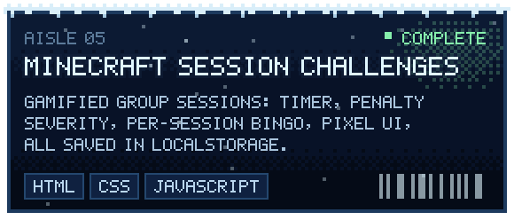
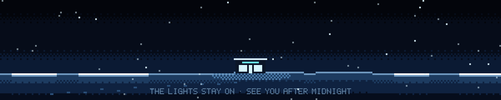

<div align="center">



<br/>

<sub>
I build software the way a night shift runs a corner store:<br/>
quietly, carefully, and ready for whoever walks in at 3am.
</sub>

<br/><br/>


</div>


### ❄ &nbsp;who's behind the counter


I'm **Isaac** — full stack developer, game dev and designer, trained as a multimedia technician. I treat software like a craft, not output: I'd rather ship one thing that feels finished than five that only work.

Most nights are split in two. Half goes into **production systems** — right now a multi-tenant ERP I'm building from the framework up. The other half goes into **game engines**, where I get to care about architecture *and* about how a summon animation feels.

I also lead the multimedia track of my class, designing the selection process for future student leaders. Good systems aren't only code — they're process design too.


```php
final class Isaac extends Developer
{
    protected array $roles  = ['full stack', 'game dev',
                               'designer'];
    protected array $traits = ['calm', 'perfectionist',
                               'always learning'];

    public function nightShift(): void
    {
        $this->sketchArchitecture()  // before code
             ->build('GhostGuard Manager')
             ->test()->refine();      // repeat
    }
}
```


### ❄ &nbsp;aisle 01 — what I'm building

<table>
<tr>
<td width="50%"><a href="https://github.com/Isaac-GhostLolp?tab=repositories"></a></td>
<td width="50%"><a href="https://github.com/Isaac-GhostLolp?tab=repositories"></a></td>
</tr>
<tr>
<td width="50%"><a href="https://github.com/Isaac-GhostLolp?tab=repositories"></a></td>
<td width="50%"><a href="https://github.com/Isaac-GhostLolp?tab=repositories"></a></td>
</tr>
</table>

<details>
<summary><b>GhostGuard Manager — recent shift log</b></summary>
<br/>

- three-tier billing: **Start · Pro · Business**
- centralized CSRF protection + a cross-tenant isolation audit
- PDF export for services and company restore
- fixes across scheduling, reporting and sales cancellation

**How I work on it:** one feature end-to-end per session (model → controller → route → view → assets), validated with real HTTP requests and Playwright screenshots. Sanitized `.env`, isolated tenants, no bloated dependencies.

</details>

<sub>&nbsp;🌙 on the back shelf: a 2D chess game with cinematic animations, an XCOM-like strategy game, and a Godot project built on Tiled maps.</sub>


### ❄ &nbsp;aisle 02 — languages & tools




### ❄ &nbsp;aisle 03 — night notes

<table>
<tr>
<td width="55%" valign="top">

**how I think about code**

- **quality** over quantity
- **architecture** before code
- **clarity** over cleverness
- **iteration** over perfection paralysis

**things that also live in my head**

- 🎮 &nbsp;I can talk for hours about game dev, anime and web architecture
- 📖 &nbsp;wrote a post-apocalyptic novella with a protagonist based on my own life
- 🎬 &nbsp;directed a short film about a detective who finds out he jailed innocent people
- 🎵 &nbsp;wrote an academic paper on how music affects us psychologically
- 🍃 &nbsp;built a QR-code vegetable traceability system in PHP

> *"Simplicity is prerequisite for reliability."* — Edsger W. Dijkstra

</td>
<td width="45%" valign="top" align="center">


</td>
</tr>
</table>


### ❄ &nbsp;aisle 04 — the security camera

<div align="center">


</div>


<div align="center">

<a href="https://isaac-ghostlolp.github.io/portifolio/"></a>
<a href="https://linkedin.com/in/Isaac_Gonçalves_Quadros"></a>
<a href="mailto:isaacgoncalves466@gmail.com"></a>
<a href="https://github.com/Isaac-GhostLolp"></a>

<br/><br/>




</div>
